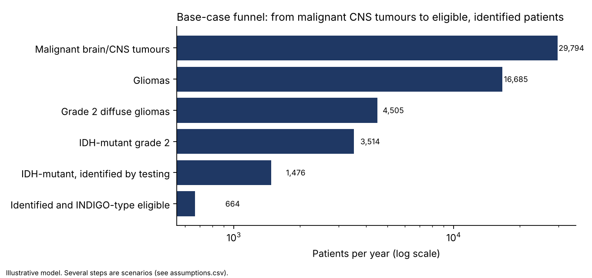
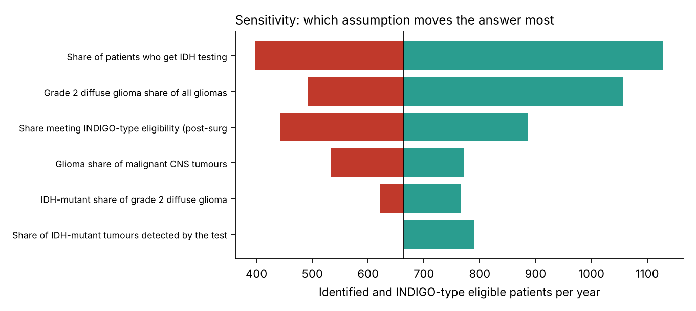
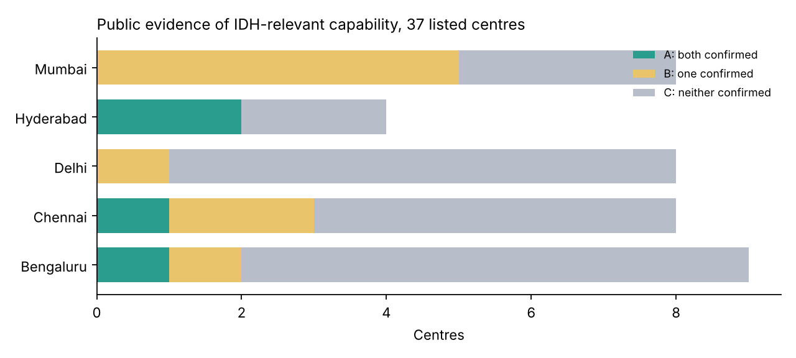

# India IDH-mutant glioma: patient funnel and access model

**Question:** How many patients in India each year are IDH-mutant grade 2 diffuse glioma, get identified by testing, and fit the clinical window studied in the INDIGO trial of vorasidenib, and which assumptions drive that number?

**Tools:** Python (pandas, matplotlib). No confidential or company data is used; every input is from a cited public source or is labelled as a scenario.

**Bottom Line:** In the base case, about 660 identified patients a year fit an INDIGO-type profile (range 148 to 3,822). The number depends mostly on how many patients get IDH testing and on the eligibility share. Neither has a published Indian figure, so treat 660 as illustrative, not as a fact.

## Summary of results (base case, low-to-high range in brackets)

| Funnel step | Patients per year |
|---|---|
| Malignant brain/CNS tumours (GLOBOCAN, India, 2024 estimate) | 29,794 |
| Gliomas | 16,685 (13,407 – 19,366) |
| Grade 2 diffuse gliomas | 4,505 (2,681 – 8,327) |
| IDH-mutant grade 2 | 3,514 (1,957 – 7,495) |
| IDH-mutant and identified by testing | 1,476 (493 – 6,370) |
| Identified and INDIGO-type eligible | **664 (148 – 3,822)** |

*Low and high columns set every uncertain input to its low or high value at once, so they bracket the extremes rather than a likely range.*

**Findings**
1. **The answer is driven by access, not biology.** One input at a time, the largest swings come from the share of patients who get IDH testing (about 400 to 1,130 eligible patients), the grade 2 share of gliomas (about 490 to 1,060), and the share fitting the INDIGO-type window (about 440 to 890). The IDH-mutation rate and test sensitivity matter much less (swings of 145 and 126).
2. **The most influential inputs are the least documented.** No Indian national testing rate or INDIGO-window share is published, so those are scenarios. The headline of about 660 patients per year is therefore illustrative, not an estimate to quote as fact.
3. **Public evidence of testing capability is thin.** Of 37 NCG-listed centres in five city groups, only 4 publicly confirm both neurosurgery and molecular pathology, 9 more confirm one, and none confirms an IDH assay. This supports treating testing rate as the key uncertainty.
4. **Steady-state pool.** Using the INDIGO median PFS (27.7 months) as a proxy for time on therapy, about 1,500 eligible, identified patients could be on treatment at any time in the base case (about 220 to 11,500 across scenarios).





## Method
1. Start from malignant brain/CNS incidence (GLOBOCAN).
2. Apply the glioma share, then the grade 2 diffuse glioma share, then the IDH-mutant share (Indian hospital series).
3. Apply the share tested and the detection sensitivity of the testing pathway.
4. Apply an INDIGO-type eligibility share (post-surgery, no prior radiotherapy or chemotherapy, measurable non-enhancing disease, KPS of 80 or more).
5. Run low/base/high scenarios and one-at-a-time sensitivity.
6. Add a separate access-gap view from public centre information.

Every parameter is in `data/assumptions.csv` with its range, evidence type (Sourced / Derived / Scenario) and source.

## Assumptions and where they come from

| Step | Base (low – high) | Evidence | Source |
|---|---|---|---|
| Malignant CNS tumours | 29,794 | Sourced | IARC GLOBOCAN, India, estimates for 2024, accessed 27 Oct 2026 |
| Glioma share of malignant CNS | 56% (45 – 65%) | Derived + scenario | Kumar et al., *Cureus* 2026 (Jaipur, n=1,315): (398 astrocytomas × (1 − 17.46% grade I) + 92 oligodendrogliomas) / 745 malignant |
| Grade 2 diffuse glioma share of gliomas | 27% (20 – 43%) | Sourced range | Thambi et al., *JCDR* 2017 (n=510): 26.9%; Kaur et al., *Neurol India* 2025: 49/115 = 42.6% of adult-type diffuse gliomas |
| IDH-mutant share, grade 2 | 78% (73 – 90%) | Sourced range | Kaur et al.: 30/41 grade 2 astrocytoma, 8/8 grade 2 oligodendroglioma, pooled 38/49 (our calculation) |
| Share tested | 50% (30 – 85%) | **Scenario** | No national figure published. ISNO consensus (Santosh et al., *Neurol India* 2019) describes an IHC-first approach and notes cost limits |
| Detection by testing pathway | 84% (84 – 100%) | Sourced + scenario | Kaur et al.: IDH1 R132H IHC sensitivity 84%; 100% assumes reflex sequencing |
| INDIGO-type window | 45% (30 – 60%) | **Scenario** | Criteria from Mellinghoff et al., *N Engl J Med* 2023; the Indian share is not published |
| Years on treatment | 2.3 (1.5 – 3.0) | Scenario anchored on a trial result | INDIGO median PFS 27.7 months (NEJM 2023) |

*Ranges come from the lowest and highest published values where available; for scenario rows they are my own judgement.*

Price reference (public): Tata 1mg lists Voranigo 40 mg, 30 tablets, MRP ₹18,60,000 and selling price ₹17,67,000 (accessed 27 Oct 2026). Price is not part of the funnel. `outputs/price_uptake_grid.csv` shows an illustrative grid of monthly price × uptake on the base steady-state pool and uses generic prices, not any real programme or negotiated price.

## Weakest parts of the method (read these before quoting any number)
1. Testing rate and eligibility share are assumptions, and they are the two biggest drivers.
2. Hospital series are not population-based.
3. The two series disagree.
4. The IDH-mutation rate comes from one centre.
5. There is no uptake or treated-patient data.

## Access-gap view
`access_gap.py` classifies 37 centres from the public-evidence file: Tier A (neurosurgery and molecular pathology both publicly confirmed), B (one), C (neither). "Not confirmed" means no adequate official source was found, not that the service is absent. A listed molecular pathology service does not prove IDH assays are done on site. The source file's Read Me says 35 centres but the sheet contains 37; this analysis uses all 37.

## How to run
```
pip install -r requirements.txt
python model.py data/assumptions.csv outputs/
python access_gap.py data/centres_public_evidence.xlsx outputs/
```
Edit `data/assumptions.csv` to change any assumption and rerun.

## Sources
- IARC GLOBOCAN, India, brain and CNS (ICD C70-72), 2024 estimates, gco.iarc.who.int/today.
- Mellinghoff IK et al. Vorasidenib in IDH1- or IDH2-mutant low-grade glioma (INDIGO). *N Engl J Med* 2023;389:589-601.
- Cloughesy TF et al. INDIGO secondary and exploratory endpoints. *Lancet Oncol* 2025.
- Kaur K, Trivedi T, Trivedi P. Clinicopathological and molecular profiling of adult-type diffuse glioma. *Neurol India* 2025;73:704-9.
- Santosh V et al. ISNO consensus guidelines for practical adaptation of the WHO 2016 classification of adult diffuse gliomas. *Neurol India* 2019;67:173-82.
- Thambi R et al. Histopathological analysis of brain tumours: a seven-year study from a tertiary care centre in South India. *J Clin Diagn Res* 2017.
- Kumar P et al. Retrospective analysis of epidemiology of intracranial and spinal tumor in North Western India. *Cureus* 2026;18:e102353.
- National Cancer Grid member list (ncgindia.org) and official hospital pages, as compiled in `data/centres_public_evidence.xlsx`.
- Tata 1mg Voranigo 40 mg listing, accessed 27 Oct 2026.
