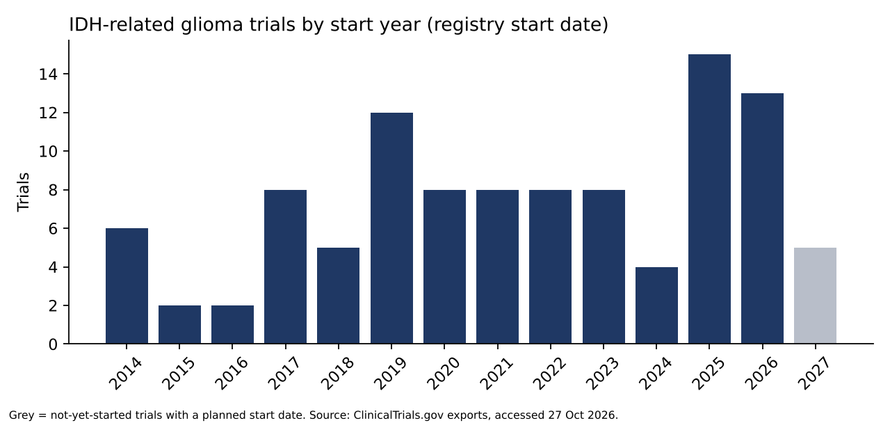
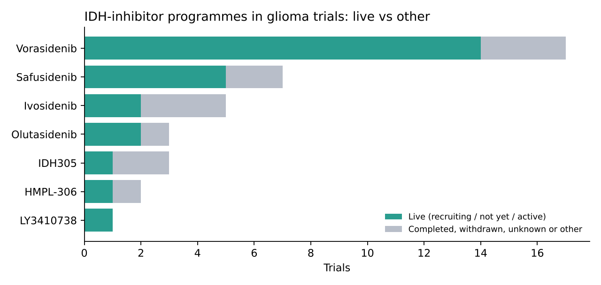
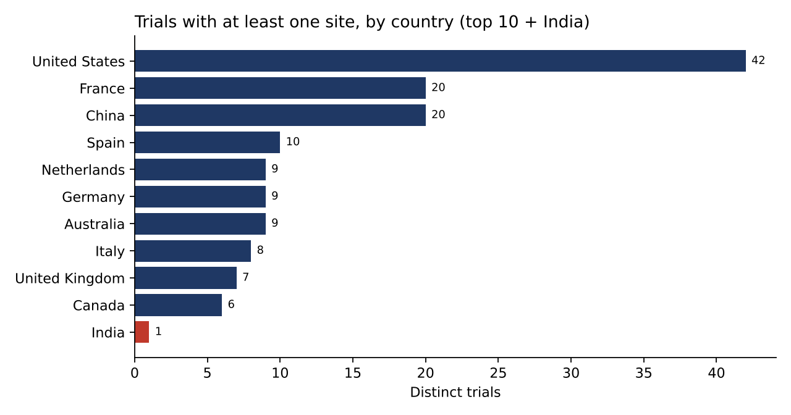

# IDH-mutant glioma: clinical trial and competitor landscape

**Question:** Who is developing IDH-targeted therapy for glioma, how mature is each programme, where are the trials running, and how visible is India?

**Why this matters:** Built to understand how mature the IDH-inhibitor field is and how visible India is in it, which shows where competition is concentrated and where India is missing from clinical development.

**Tools:** SQL (SQLite: joins, CTEs, RANK, LAG), Python (pandas, matplotlib), Power BI-ready exports.
**Data:** ClinicalTrials.gov exports run on 27 Oct 2026 (public registry data only).

## Key findings
1. **Vorasidenib has the broadest programme.** 17 registered trials, 14 of them live (recruiting, not yet recruiting, or active). Four are phase 3: INDIGO, the Asian-participant phase 3, an Alliance trial adding it to temozolomide after radiation, and an EORTC maintenance trial.
2. **Safusidenib is the nearest challenger.** 7 trials (5 live), with two phase 3 trials (SIGMA and a second study not yet recruiting). Ivosidenib (5 trials, 2 live) and olutasidenib (3 trials, 2 live) have no phase 3 glioma trial in this dataset.
3. **Sponsor concentration.** Among 69 interventional IDH-related trials, the Servier group sponsors 9 (6 live), the NCI/NIH 5 (4 live), Nuvation Bio 3 (all live), and Assistance Publique – Hôpitaux de Paris 3.
4. **Geography is Western- and China-centred.** The United States has sites in 42 of 109 IDH-related trials, France 20, China 20, then Spain, the Netherlands, Germany and Australia. **India appears in only 1 of 109.** That trial is a phase 1 study of a PRMT5 inhibitor (JBI-778, Jubilant) with an IDH-mutant glioma cohort, at six Indian hospitals. No IDH-inhibitor trial in this dataset lists an Indian site.
5. **Most trials are early stage.** Among 69 interventional IDH-related trials, 22 are phase 2, 18 phase 1, 8 phase 3, 7 early phase 1, 5 phase 1/2, 1 phase 4, and 8 do not state a phase.
6. **Start dates cluster in 2019 and 2025–26.** There were 12 starts in 2019 and 15 and 13 in 2025 and 2026 (2026 is a partial year). 2024 had only 4. Planned start dates are included for trials not yet started.





## Method
1. Merge three registry exports (glioma + IDH search; glioma + IDH-inhibitor drug names; one partial record) and remove duplicates on NCT number. 144 studies.
2. Flag IDH-related studies by keyword (IDH, isocitrate) in the title, interventions or summary: 109 studies, of which 69 are interventional.
3. Match IDH-inhibitor programmes (vorasidenib, safusidenib, ivosidenib, olutasidenib, HMPL-306, IDH305, LY3410738, enasidenib) on the interventions field, including code names such as AG-881 and DS-1001.
4. Split the site list into one row per site, and take the country as the last comma-separated token (so "Indiana" is not counted as India).
5. Group sponsor-name variants (for example four Servier names) into one organisation.
6. Run seven SQL queries (`sql/queries.sql`) and chart the results.

## Limitations and Caveats
1. **The dataset is search-defined, not exhaustive.** It comes from two registry searches. Trials that mention neither glioma nor a listed drug in the searched fields would be missed, and so would new agents not on my drug list.
2. **Keyword flags are approximate.** The IDH-related flag includes summary text, and drug matching depends on name aliases. A few trials could be mis-flagged and I did not review every record by hand.
3. **Planned dates move.** Not-yet-recruiting trials carry expected start dates that can slip, and registry statuses are a snapshot of 27 Oct 2026.
4. **Trial counts are not investment, patients or success.** A count of trials says nothing about size, quality or likelihood of approval.
5. **One partial record.** NCT07286292 (pediatric vorasidenib, Servier) is included from a basic export and lacks phase, start date and locations, so it counts in drug and sponsor tallies but not in phase, year or country charts.

## How to run
```
pip install -r requirements.txt
python build_db.py outputs/trials.db data/ctg_glioma_idh.csv data/ctg_drug_search.csv data/ctg_supplement_partial.csv
python run_queries.py outputs/trials.db sql/queries.sql outputs/
python make_charts.py outputs/trials.db outputs/
python export_powerbi.py outputs/trials.db outputs/powerbi/
```

## Data sources
ClinicalTrials.gov (U.S. National Library of Medicine) searches run 27 Oct 2026: (a) condition "glioma", other terms "IDH"; (b) condition "glioma" with intervention names for IDH inhibitors; plus one partial record from an earlier basic export.
